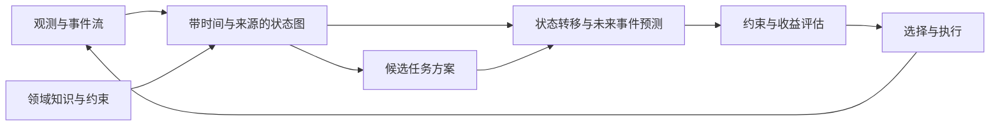

# 知识图谱增强的态势预测与指挥决策：首轮调研

调研日期：2026-10-23。范围：公开论文、作者工程与通用基础组件。这是首轮有来源的研究地图，并非系统综述或已完成的复现实验。逐篇阅读深度见论文索引。

## 1. 课题应该放在哪条研究线上

建议采用工作题目：**面向动态态势的知识图谱增强世界模型与任务规划研究**。如果暂时没有行动后的状态转移数据，可以先收敛为“基于时序知识图谱的态势演化预测与可解释决策支持”。前者要求验证预测与行动之间的闭环，后者可以先研究事件预测和证据推理。

“任务规划是世界模型的一个分支”可以作为检索入口，但更准确的关系是：世界模型提供状态和环境变化模型，规划器利用模型评价未来行动。规划还包括不使用学习世界模型的符号规划、优化求解等路线。[世界模型综述 P01](https://arxiv.org/abs/2411.14499v4)、[RAP P07](https://arxiv.org/abs/2305.14992)提供了两个不同入口。

| 名称/检索术语 | 解决什么 | 与本课题的关系 |
|---|---|---|
| World Model / Model-based Planning | 表示状态，模拟变化，支持行动选择 | 总体研究框架 |
| Knowledge Graph-based / Graph World Model | 用实体、关系和图变化表示世界 | 最贴合的模型形态；一般图模型未必有知识语义 |
| Temporal KG Forecasting / Extrapolation | 从历史事件图外推未来事实 | 态势预测的可复现切口 |
| Situation Awareness / Assessment / Projection | 感知、理解和推测态势 | 领域检索入口，三类任务应分别评价 |
| Neuro-symbolic Planning / PDDL / HTN | 用符号状态、动作约束和层级任务规划 | 保证方案可执行性的候选路线 |
| GraphRAG / Temporal Agent Memory | 检索知识、维护动态记忆、追溯证据 | 支撑组件；需要额外的预测和规划模块 |
| Decision Support / Course of Action Analysis | 比较方案并辅助人作决定 | 应用目标，不能只用回答流畅度评价 |

这张分类表是本调研的分析框架，不代表上述名称在论文中完全同义。

## 2. 三个必须分开的能力

**态势理解**：当前哪些事实成立？图问答、关系补全、意图识别通常属于这里。

**态势预测**：已知历史，未来更可能出现什么事件？[RE-GCN P11](https://arxiv.org/abs/2104.10353)与[TLogic P12](https://ojs.aaai.org/index.php/AAAI/article/view/20330)是代表性方法，但未来链接排序仍然只是态势预测的一种简化。

**行动条件预测与规划**：如果选择不同动作，未来状态、代价和可行性有何不同？[Worldformer P04](https://arxiv.org/abs/2106.09608v2)明确学习行动引起的图变化；[KGLAMP P09](https://arxiv.org/abs/2602.04129v2)则侧重图约束下的符号规划与重规划。两者可分别借鉴动态预测和约束执行。

特别注意：历史相关性不等于干预因果性；图上写有“导致”关系，也需要检验关系来源、成立条件和干预证据。对课题而言，“知识图谱增强在哪里、改善了哪个任务”应比模型命名更优先。

## 3. 最值得先读的材料

| 顺序 | 材料 | 建议带着什么问题读 |
|---|---|---|
| 1 | P01 世界模型综述 | 理解表示、预测与规划的边界 |
| 2 | P04 Worldformer | 怎样把动作输入变成图状态变化预测？ |
| 3 | P05 AriGraph | 结构化记忆怎样改善长任务？是否有独立的动态模型？ |
| 4 | P08 DAVIS | 时序记忆和反思如何参与规划、检索与重规划？ |
| 5 | P11 RE-GCN + P12 TLogic | 神经预测与规则预测各自有什么优势？ |
| 6 | P09 KGLAMP | 知识如何转换为可验证的规划约束？ |
| 7 | P15 E-KELL + P16 ARES-KG | 领域系统如何组织知识和评价辅助决策？哪些能力尚未验证？ |

完整的 21 项索引、来源与局限见 [论文卡片](02_论文卡片.md)。P10 是较新的审稿中工作，可作为多步误差问题线索，不宜当成已确立的结论。

## 4. 现有研究给出的启发

图可以承担不同角色。AriGraph 主要启发**状态与记忆组织**；RE-GCN/TLogic 主要启发**未来事件预测**；KGLAMP 启发**约束表达及重规划**；E-KELL/ARES-KG 启发**领域知识查询与解释**。因此，不宜把这些论文直接放进同一张准确率排行榜。

目前核实的 ARES-KG 仓库包含 CSV、文档形式的 Cypher 脚本和场景材料，属于研究工件。其论文报告的是概念验证与小样本专家评价，并明确未完成实际 C2 系统集成；这些证据支持把它作为领域原型参考，尚不足以证明真实环境中的规划收益。[论文 P16](https://www.mdpi.com/2673-9585/6/3/16)、[作者仓库](https://github.com/dimitrisdoumanas19/DSS-ARESKG)。

本轮中文材料更多落在态势估计、行动判识和意图识别环节。它们适合支持领域背景与状态定义；是否实现多步预测或行动方案比较，需要取得全文后逐篇核验。[态势估计 P17](https://jcdz.cbpt.cnki.net/portal/journal/portal/client/paper/1c4b40ac6cea80db58edd9c07927c151)、[行动判识 P18](https://opaj.napstic.cn/periodicalArticle/0120240703074246)。

## 5. 建议的研究闭环

以下为本调研提出的可验证方案，不是某篇论文已经实现的系统。先以应急救援或资源调度仿真为验证场景，便于获得状态真值、动作效果与公开可复现实验。

状态图至少区分：静态知识、已观测事实、预测事实、假设方案。保留事实有效时间、记录时间、来源与置信度，避免把过时信息或预测结果当成已发生事实。Graphiti 可参考动态事实存储；它本身不替代未来预测模块。[P20 及官方工程](https://github.com/getzep/graphiti)。

阶段一可实现历史事件图到未来事件的预测，先比较频率/最近事件、RE-GCN、TLogic。阶段二加入动作变量，在仿真中学习或验证图状态转移。阶段三比较短视规划与多步规划，并在执行反馈后更新状态。

不要一开始同时训练视觉生成模型、领域大模型和多智能体系统。先证明知识图谱在固定任务上提高预测或决策质量，再增加复杂性。

## 6. 实验设计与可写成论文的问题

| 研究问题 | 对照与消融 | 主要指标 |
|---|---|---|
| 结构化知识是否改善未来事件预测？ | 历史统计、RE-GCN；去掉领域关系/规则 | 时间外推 MRR、Hits@K；若输出概率则评估校准 |
| 时间信息是否改善状态一致性？ | 静态图 vs 时间图；去掉失效与冲突处理 | 状态正确率、陈旧事实比例、更新延迟 |
| 行动条件图模型是否改善任务规划？ | 无预测、单步预测、多步预测；相同搜索预算 | 任务成功率、约束违反率、资源代价、规划耗时 |
| 多步预测何时失效？ | 不同预测跨度、观测缺失、图结构变化 | 各预测跨度误差、决策收益下降、重规划次数 |
| 解释是否与决策证据一致？ | 无证据解释 vs 可追溯图路径 | 证据可追溯率、解释忠实性、人类复核结果 |

划分必须按时间推进。训练阶段不能使用未来事实；测试时逐时刻获得新观测的设置，与无新观测的自主多步滚动预测应分别报告。不同数据集和过滤协议下的 MRR 不可直接横比。专家主观评分适合作为补充，不替代闭环任务结果。

可考虑三个课题收敛方向：①带时间与置信度的知识图谱增强事件预测；②面向动态任务的图状态约束与反馈重规划；③多步图世界模型的误差控制与规划效用。是否具有新颖性仍需围绕最终任务补查近作，不能仅由这轮检索认定。

## 7. 需要补齐的证据

本轮未训练模型、运行作者项目或验证指标。领域论文的数据可获得性通常弱于通用文本环境和时序图基准。KGLAMP、Worldformer 等未确认的代码地址保留为空，不能据此断言作者没有开源。

后续优先精读 P04/P05/P08/P09 的实验和消融，明确图记忆、预测器、规划器的实际分工；再确定任务数据，复现 P11/P12 中至少一个基线。所有工程的依赖、授权与复现状态单列记录，避免将“有 GitHub”写成“已复现”。
